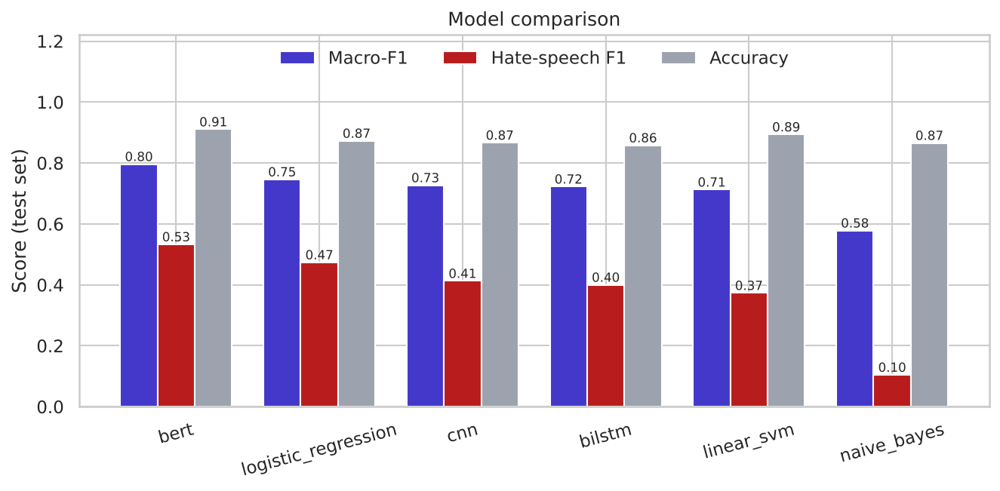
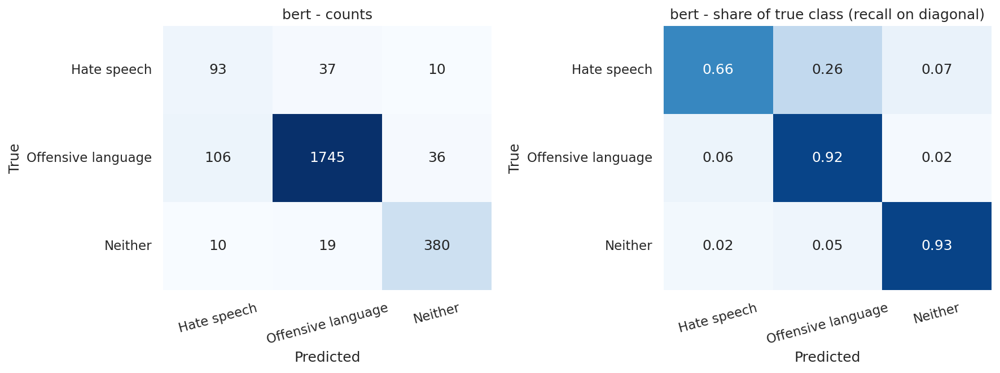

# Context-Aware Hate Speech Detection

**An explainable transformer-based NLP system for social media content analysis.**

Classifies English text as **hate speech**, **offensive language** or **neither**, compares six
models from TF-IDF baselines to fine-tuned BERT, explains predictions with LIME, audits bias and
robustness, and serves everything through a Streamlit app.

> **Content warning.** The dataset contains racist, sexist, homophobic and otherwise offensive
> language. It is never committed to this repository.
>
> **Not a moderation system.** This is a decision-support prototype. Read
> [Responsible AI](#responsible-ai) before using it on anything real.

## Status

All six models have been trained and evaluated on the real dataset (November 2026); see
[Results](#results). Every number in this README is copied from the files in `reports/`, which
the scripts generate. Each model was trained once with a fixed seed, so treat small differences
between models as noise.

## Project structure

```
hate-speech-detection/
├── app/streamlit_app.py          Streamlit interface
├── configs/config.yaml           every hyper-parameter and path
├── data/raw, data/processed      dataset and saved splits (git-ignored)
├── docs/                         dataset card, interview guide
├── models/                       trained artefacts (git-ignored)
├── notebooks/                    EDA notebook, Colab BERT training notebook
├── reports/                      metrics, figures, comparison, audits
├── scripts/setup_d_drive.ps1     puts pip / Hugging Face / PyTorch caches on D:
├── src/
│   ├── data/                     download, load + validate, split, EDA
│   ├── preprocessing/            text cleaning, vocabulary
│   ├── models/                   baselines, TextCNN, BiLSTM, BERT
│   ├── training/                 train_baselines, train_neural, train_bert
│   ├── evaluation/               metrics, plots, comparison, error analysis, bias, robustness
│   ├── explainability/           LIME + linear-model coefficients
│   ├── inference/                Predictor (one interface for all models)
│   └── utils/                    config, logging, device detection, MLflow wrapper
└── tests/                        pytest suite
```

## Setup on Windows (PowerShell)

Developed and run with Python 3.12 (3.11 also works). Rough disk needs (estimates): 6-8 GB with CPU-only PyTorch, 12-15 GB with
the CUDA build, counting the virtual environment, pip cache, BERT weights and one fine-tuned
checkpoint.

The project has no hard-coded location: every path is resolved relative to the project folder,
so it runs from wherever it is placed. The commands below assume `D:\Projects\hate-speech-detection`.

```powershell
cd D:\Projects\hate-speech-detection
Set-ExecutionPolicy -Scope Process -ExecutionPolicy Bypass   # allows scripts in this terminal only

# Send the pip, Hugging Face and PyTorch caches (and this terminal's TEMP) to D:\Caches.
# Re-run in every new terminal before a `pip install`.
.\scripts\setup_d_drive.ps1

py -3.12 -m venv .venv          # the environment lives inside the project folder, on D:
.\.venv\Scripts\Activate.ps1

python -m pip install --upgrade pip
```

### Install PyTorch

- **No NVIDIA GPU (or unsure):** skip this step; the next command installs the CPU build.
- **NVIDIA GPU:** install the CUDA build first, using the exact command for your CUDA version
  from <https://pytorch.org/get-started/locally/> (it looks like
  `pip install torch --index-url https://download.pytorch.org/whl/cu1xx`).

```powershell
pip install -r requirements.txt
python -m src.utils.runtime        # prints OS, Python, torch version, GPU or CPU
python -m pytest                   # the test suite should pass before you train anything
```

## Run the pipeline

Run from the project root with the virtual environment active. Each step writes files that the
next one reads.

| Phase | Command | Output |
|---|---|---|
| 2 Data | `python -m src.data.download` | `data/raw/labeled_data.csv` + checksum |
| 2 EDA | `python -m src.data.eda` | `reports/eda_summary.md`, class and length plots |
| 2 Split | `python -m src.data.split` | `data/processed/{train,val,test}.csv` |
| 3 Baselines | `python -m src.training.train_baselines` | 3 models, metrics, confusion matrices |
| 4 CNN | `python -m src.training.train_neural --model cnn` | model, loss curves |
| 4 BiLSTM | `python -m src.training.train_neural --model bilstm` | model, loss curves |
| 5 BERT | `python -m src.training.train_bert` | `models/bert/`, loss curves |
| 6 Compare | `python -m src.evaluation.evaluate` | `reports/model_comparison.{csv,md}`, chart |
| 6 Errors | `python -m src.evaluation.error_analysis --model bert` | `reports/error_analysis/bert.md` |
| 7 Explain | `python -m src.explainability.lime_explainer --model bert` | `reports/explainability/bert_lime.md` |
| 7 Bias | `python -m src.evaluation.bias_audit --model bert` | `reports/bias/bert.md` |
| 7 Robustness | `python -m src.evaluation.robustness --model bert` | `reports/robustness/bert.md`, chart |
| 8 App | `streamlit run app/streamlit_app.py` | opens <http://localhost:8501> |

Any `--model` flag accepts `bert`, `cnn`, `bilstm`, `logistic_regression`, `linear_svm` or
`naive_bayes`. One-off prediction from the terminal:

```powershell
python -m src.inference.predictor --model logistic_regression --text "have a nice day"
```

If the download step fails (firewall, proxy), open the URL in `configs/config.yaml` in a browser
and save the file as `data\raw\labeled_data.csv`.

## Training BERT without a GPU

The baselines, CNN and BiLSTM train on a CPU in minutes. Full BERT fine-tuning on a CPU is
possible but slow (expect hours). Options, best first:

1. **Google Colab (free T4 GPU).** Open `notebooks/colab_train_bert.ipynb` in Colab and follow
   it. It trains BERT and downloads `bert_artifacts.zip`; unzip that into the project root so
   that `models\bert\` and `reports\` are filled in.
2. **Smoke test locally** to prove the code path works, on a small subset:
   `python -m src.training.train_bert --max-train-samples 2000 --epochs 1 --output-name bert_smoke`
   The result is tagged `smoke_test` and must not be reported as a result.
3. **A smaller transformer on CPU:**
   `python -m src.training.train_bert --model-name distilbert-base-uncased --output-name distilbert`
4. Out of GPU memory? Add `--batch-size 8`.

## Design decisions

| Decision | Reason |
|---|---|
| Macro-F1 is the selection metric | About 77% of tweets are "offensive"; accuracy rewards ignoring hate speech. |
| Class-weighted loss, no oversampling | Handles imbalance without duplicating or inventing text. |
| De-duplicate before a stratified 80/10/10 split | Retweets would otherwise leak between train and test. |
| Splits saved to disk | Every model is compared on identical rows. |
| Vectoriser inside the sklearn `Pipeline` | TF-IDF statistics come from training text only. |
| Two cleaning levels | BERT needs natural text; bag-of-words models need normalised text. |
| Handles and URLs masked | Removes noise and keeps usernames out of models and reports. |
| Hand-written BERT training loop | Every step is visible and explainable; allows weighted loss directly. |
| LIME for explanations | One model-agnostic method for all six models, light enough for a CPU app. |
| MLflow, optional | Local run tracking (`mlflow ui --backend-store-uri sqlite:///mlflow.db`). Training never depends on it. |
| No DVC | One 2.5 MB public file, reproduced by a download script with a checksum. DVC would add a remote and extra commands without benefit at this size. |

Longer explanations, written as interview answers, are in
[docs/INTERVIEW_GUIDE.md](docs/INTERVIEW_GUIDE.md). Dataset source, licence, structure and
limitations are in [docs/DATASET_CARD.md](docs/DATASET_CARD.md).

## Results

Held-out test set: 2,436 tweets (140 hate speech, 1,887 offensive, 409 neither). Source:
`reports/model_comparison.md`.

| Model | Macro-F1 | Accuracy | Hate-speech F1 | Hate-speech recall | Offensive F1 | Neither F1 |
|---|---:|---:|---:|---:|---:|---:|
| **BERT (fine-tuned)** | **0.797** | **0.911** | **0.533** | **0.664** | 0.946 | 0.910 |
| TF-IDF + Logistic Regression | 0.746 | 0.873 | 0.474 | 0.614 | 0.920 | 0.844 |
| TextCNN | 0.727 | 0.867 | 0.413 | 0.557 | 0.918 | 0.850 |
| BiLSTM | 0.722 | 0.858 | 0.400 | 0.629 | 0.916 | 0.851 |
| TF-IDF + Linear SVM | 0.713 | 0.894 | 0.373 | 0.279 | 0.936 | 0.829 |
| TF-IDF + Naive Bayes | 0.578 | 0.866 | 0.105 | 0.057 | 0.922 | 0.708 |





How the models were run: the baselines, CNN and BiLSTM were trained on a laptop CPU. BERT was
fine-tuned on a Google Colab T4 GPU (3 epochs, about 6 minutes, best epoch 2) using the same
saved train/validation/test split files as the other models, then evaluated and served locally.

### What the results show

- **BERT is the best model on every headline metric**, about 0.05 macro-F1 ahead of logistic
  regression. Its largest gains are on the hate-speech and neither classes.
- **Hate speech is the hard class for every model.** BERT's hate-speech F1 is 0.53, against 0.95
  for offensive language. It finds 93 of the 140 hate tweets (recall 0.66), but only 93 of the
  209 tweets it labels as hate really are (precision 0.44). The most common error by far is
  offensive language predicted as hate speech (106 tweets), a consequence of weighting the rare
  class heavily in the loss.
- **Accuracy hides failure.** Naive Bayes reaches 87% accuracy while finding 6% of hate speech;
  the linear SVM has the second-highest accuracy and finds 28%. This is why macro-F1 is the
  selection metric.
- **A simple baseline is competitive.** Logistic regression on TF-IDF beats both the CNN and the
  BiLSTM, whose embeddings were learned from scratch on about 19k tweets.

### Bias audit (BERT): the model over-flags identity terms

Source: `reports/bias/bert.md`.

- **Template probe.** Harmless sentences such as "I am <identity>." should all be "neither".
  BERT flagged 35.9% of them (28 of 78), all as hate speech, and 0 of 5 control sentences
  without an identity term. Every sentence containing "gay", "lesbian" or "transgender" was
  flagged (18 of 18); "christian", "hindu" and "disabled" were never flagged.
- **Test set.** Tweets whose true label is "neither" were flagged 15.4% of the time when they
  mention an identity term (n = 39) against 6.2% otherwise (n = 370). The first group is small,
  so that rate is imprecise.

The model has learned that certain identity words predict hate, because in this lexicon-sampled
dataset those words occur mostly in abusive tweets. In deployment this would silence the very
groups a hate-speech filter is meant to protect. It is the strongest reason this system must not
make moderation decisions on its own. Mitigations not yet attempted: counterfactual data
augmentation, identity-term debiasing, evaluation on HateCheck.

### Robustness (BERT)

Source: `reports/robustness/bert.md`, stratified sample of 500 test tweets.

| Perturbation | Macro-F1 | Predictions changed |
|---|---:|---:|
| None (clean sample) | 0.772 | - |
| Swapped letters (typos) | 0.694 | 8.8% |
| Leetspeak (a to @, e to 3) | 0.686 | 9.4% |
| Dotted letters (w.o.r.d) | 0.698 | 8.4% |
| Upper case | 0.772 | 0.0% |
| Friendly text appended | 0.782 | 1.2% |

Character-level obfuscation costs about 0.08 macro-F1; casing has no effect (the model is
uncased) and appended friendly text has almost none. Only BERT was tested, so this says nothing
about whether the other models are more or less robust.

### Limits of these numbers

- One training run per model, one random split. No confidence intervals.
- 140 hate-speech tweets in the test set: a handful of tweets moves hate-speech F1 by a point.
- The CNN's and BERT's validation loss rose while validation macro-F1 was still improving, so
  their probabilities are probably overconfident; no calibration was done.
- The BiLSTM's best epoch was its last (10 of 10) and the best Naive Bayes smoothing value was
  at the edge of its grid, so both may be slightly under-tuned.

## Responsible AI

- **Human in the loop.** Output is a signal for prioritising human review, not a verdict.
- **Subjective labels.** The classes come from crowd workers' majority votes; the border between
  offensive and hateful is contested, and the model inherits that noise.
- **Lexicon-sampled data.** Tweets were collected by searching for hateful terms, so explicit
  slurs are over-represented and implicit hate is under-represented.
- **Dialect and identity bias.** Audits by the dataset's own authors found that classifiers
  trained on it flag African-American English more often. `bias_audit` measures a narrower thing
  (false positives on identity mentions); it cannot measure dialect bias.
- **Missing context.** Quoting, sarcasm, reclaimed terms and counter-speech are frequent error
  sources. See the error analysis report.
- **Explanations are approximate.** LIME shows which words change the output when removed. It
  does not reveal the model's reasoning and does not validate a prediction.
- **Scope.** English tweets from one period. Performance elsewhere is unknown.

## Tests

```powershell
python -m pytest            # all tests
python -m pytest -k neural  # PyTorch model tests only
```

Tests use a small synthetic corpus of meaningless words. It is never used to train or evaluate a
real model.

## Publish to GitHub

`.gitignore` already excludes the dataset, model weights, predictions and logs.

```powershell
git init
git add .
git status                  # check: nothing from data\raw, models\ or .venv is listed
git commit -m "Hate speech detection: baselines, CNN, BiLSTM, BERT, explainability, app"
git branch -M main
git remote add origin https://github.com/<your-username>/hate-speech-detection.git
git push -u origin main
```

Create the empty repository on github.com first (no README, no licence, so the push is not
rejected). To share the fine-tuned BERT weights, upload `models/bert/` to the Hugging Face Hub
or attach it to a GitHub Release rather than committing it.

## Troubleshooting

| Problem | Fix |
|---|---|
| `ModuleNotFoundError: No module named 'src'` | Run commands from the project root, as `python -m ...`. |
| `Activate.ps1 cannot be loaded` | `Set-ExecutionPolicy -Scope Process -ExecutionPolicy Bypass` |
| `python -m src.utils.runtime` shows no GPU although you have one | The CPU build of torch is installed. `pip uninstall torch`, then install the CUDA build. |
| BERT download fails | The first run needs internet access to huggingface.co. |
| MLflow errors | Set `tracking.use_mlflow: false` in `configs/config.yaml`. |

## Citation

Davidson, T., Warmsley, D., Macy, M., and Weber, I. (2017). *Automated Hate Speech Detection and
the Problem of Offensive Language.* ICWSM.
